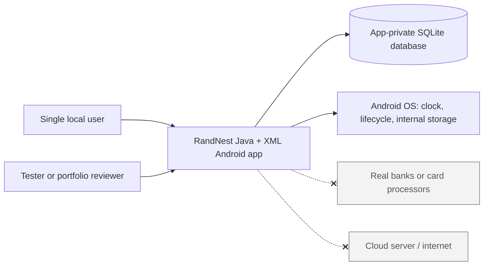
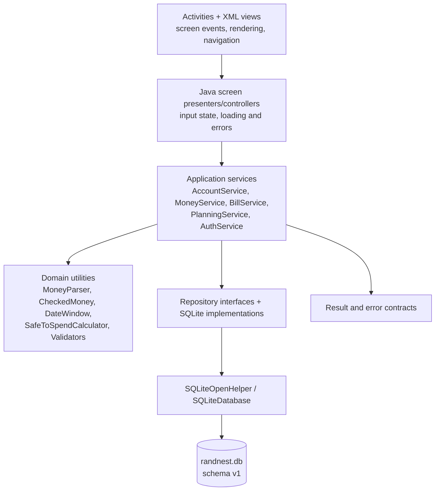
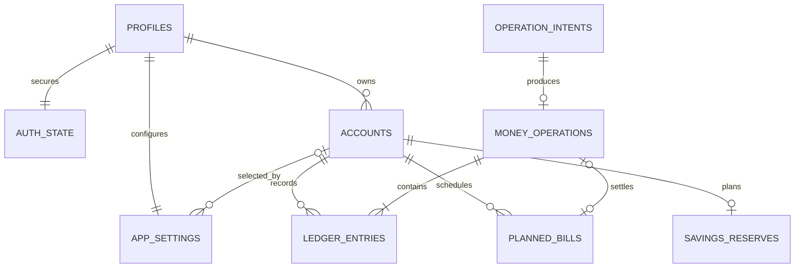
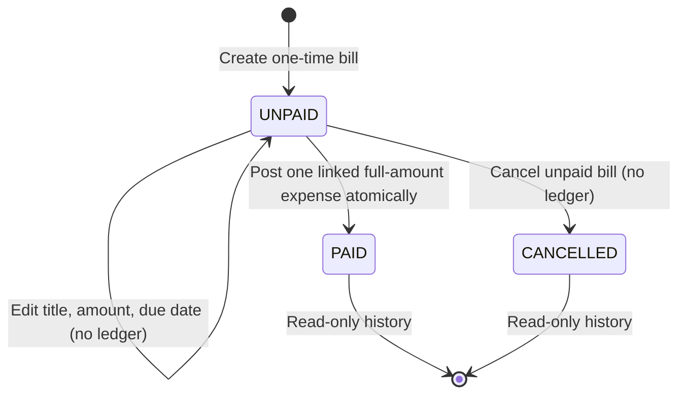
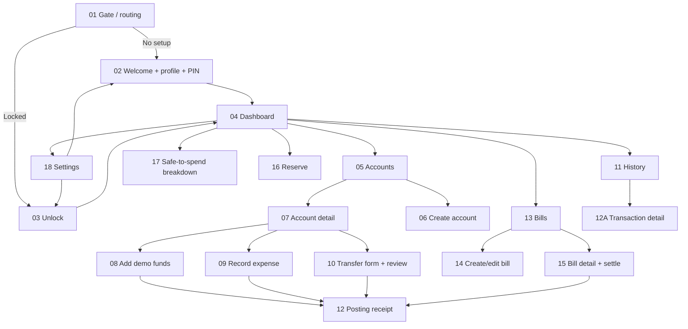

# RandNest — SDLC Phase 3: System Design

> **Project:** RandNest (working name)  
> **Tagline:** Your money. Your plan. Your control.  
> **Document ID:** RN-DES-003  
> **Version:** 1.0 — Design proposed for owner approval  
> **Prepared:** 18 November 2026  
> **Status:** **AWAITING PHASE 3 APPROVAL — do not treat design choices as approved until reviewed**  
> **SDLC phase:** 3 of 6 — System Design  
> **Approved inputs:** [01_REQUIREMENTS_ANALYSIS.md](./01_REQUIREMENTS_ANALYSIS.md), RN-SRS-001; [02_PROJECT_PLANNING.md](./02_PROJECT_PLANNING.md), RN-PLAN-002 (both approved by project owner in chat, 18 November 2026)  
> **Next phase:** `04_IMPLEMENTATION.md` — Implementation  
> **Audience:** Project owner; Java/Android developer; UX designer; database reviewer; software tester; portfolio reviewer

---

## 1. Document control and implementation contract

### 1.1 Purpose

This is the **technical blueprint** for the approved minimum viable product (MVP). A competent Android developer should be able to build the application from this document and the approved Phase 1 and Phase 2 files without inventing account rules, transaction structures, database relationships, navigation or security behavior. It defines **how** RandNest must implement the approved **what** and **why**; it does not replace the requirements.

**Scope:** An offline-first **simulation** using **Android Studio, Java-only authored application code, Android XML views, and built-in `SQLiteOpenHelper`/`SQLiteDatabase`**. One local profile controls multiple owned virtual ZAR accounts; funding, expenses and internal transfers affect a signed-entry ledger; one-time bills and planned reserves produce a 30-day safe-to-spend estimate. No real money, real bank credentials, banking API, external backend, cloud synchronization, or mandatory Play Store publishing.

**Authority precedence:** (1) approved Phase 1 business requirements, (2) approved Phase 2 scope and delivery constraints, (3) this Phase 3 design **after** approval, (4) implementation and tests. If these conflict, document a change request. Approval of Phases 1–2 does **not** mean the project already has working source code or a tested database.

### 1.2 Terminology

| Term | Definition |
|---|---|
| **Posted balance** | Sum of signed, successfully committed ledger entries belonging to one virtual account; no separately editable balance column. |
| **Operation** | One immutable financial event, such as funding, expense, transfer or bill settlement. |
| **Ledger entry** | One signed (`+` or `−`) account effect from an operation. Transfers have two entries. |
| **Submission intent** | A persistent, uniquely identified review/confirmation request; permits safe retries after interruption. |
| **Commitment** | An unpaid one-time bill; planning data, **not** a posted expense. |
| **Reserve** | A discretionary amount set aside for planning; **does not** move money. |
| **Safe to spend** | Posted balance of the selected Spending account minus relevant unpaid bills minus reserve; can be negative. |
| **Today** | Device-local calendar date, calculated anew when displaying/committing relevant changes. |
| **Simulation** | All accounts, amounts, and transfers are fictional and kept locally on the device. |

### 1.3 Design decision register (owner reviews these in Phase 3)

| Decision | Selected design | Rationale / constraints |
|---|---|---|
| D3-01 | **Java, platform `Activity` + XML views**, no Compose, no Kotlin source | Minimal dependency overhead for a portfolio project; explicit screen navigation. |
| D3-02 | **Layered architecture**: Activities → presenters/services → repositories → SQLite | Keeps UI out of SQL and makes financial rules testable. |
| D3-03 | **Ledger as authoritative source of balances**; compute `SUM(delta_cents)` | Removes risk of silently edited or stale cached balances. |
| D3-04 | One transaction for an operation, its ledger entries, bill settlement (if any) and intent status | Meets atomicity and auditability. |
| D3-05 | Persistent UUID **submission intents** and unique posted operation IDs | Defends against duplicate taps, uncertain success, and retries. |
| D3-06 | User-confirms all money postings; transfer confirmation is mandatory | Unifies safety and confirmation UI. |
| D3-07 | **Full bill settlement through a newly created linked expense** only | Meets the approved Phase 2 default; linking an arbitrary old expense is deferred. |
| D3-08 | **One Spending account selected for planning**, its own reserve and due-through-day-30 unpaid bills | Matches BR-11–BR-15. |
| D3-09 | **Six-to-twelve digit local app PIN**, salted PBKDF2 verifier, local failed-attempt delays | Casual-access protection; not database encryption or real banking authentication. |
| D3-10 | Relock on cold process start, manual Lock, or return after **60 seconds** backgrounded | Testable UI-level access rule; device security is still separate. |
| D3-11 | **No app backup/export/restore**; explicitly exclude records from supported backup/transfer channels and test | Prevent inadvertent portability of verifier and financial records. |
| D3-12 | **Min SDK 26, compile/target SDK 36**, JDK 17, AGP 8.13.2, Gradle 8.13 | Documented compatible baseline, subject to first local build validation. |
| D3-13 | ISO `YYYY-MM-DD` dates for bills, UTC epoch milliseconds for event timestamps | Reliable local-date comparisons and newest-first history. |
| D3-14 | Package `com.randnest.app` **provisional** | Change before publishing if collision/trademark check requires it. |

**Design classifications:** D3-01–D3-14 are **proposed design decisions** pending this Phase 3 approval. Phase 2's approved scope, budgets and requirement priorities remain unchanged. Any later change to a financial rule requires an impact assessment and updated tests.

---

## 2. System context, boundaries and architecture

### 2.1 Context diagram



No server trust boundary is crossed, and `android.permission.INTERNET` is **not requested**. The simulator never handles actual banking payments or user bank authentication.

### 2.2 Architectural layers



**Dependency rule:** UI objects never execute SQL, SQL classes never hold an `Activity`, and pure calculators never depend on Android classes. Repository methods expose typed Java models, not raw `Cursor` objects to Activities. Only the SQLite implementation may hold or open a database handle. Financial posting goes **exclusively** through the money service/repository transaction coordinator.

### 2.3 UI approach and lifecycle

- **Platform Activities and XML** (not fragments) are the proposed MVP implementation. This creates more small screen classes but fewer navigation dependencies and no Kotlin/Compose requirement. A later refactor to AndroidX is permissible via change control.
- `GateActivity` is the only exported launcher. After querying setup state on the disk executor, route to onboarding, unlock, or protected dashboard. All other Activities use `android:exported="false"`.
- A shared `BaseProtectedActivity` checks the in-memory session on `onStart`/`onResume`, clears protected back stacks when locked, and never trusts an Intent extra claiming authentication.
- Explicit `Intent`s pass only immutable business IDs and action modes; **requery all financial values** from SQLite after navigation. A previously displayed balance or note is not a source of truth.
- A shared navigation renderer provides Home, Accounts, Bills, History and Settings destinations. Back goes to the previous form/list; it **must never** let a locked user reach protected content via Back/Recents.
- Every important screen re-queries data on `onResume` or after a successful mutation. Background reads and writes use a **single-thread `ExecutorService`** for deterministic ordering in this small app; UI results are marshalled to the main thread with a `Handler(Looper.getMainLooper())` and ignored if the Activity is no longer active. Use `onSaveInstanceState` for ordinary input drafts and persistent submission intents for financial confirmations. No database operation on the main/UI thread.
- Process death clears the unlocked session. On a return after **60 s** in the background, require PIN again; short app switches inside 60 s may resume. Do not confuse a configuration change (rotation) with intentional backgrounding. A manual **Lock app** command locks immediately. This is a convenience lock, not a hard confidentiality claim.

### 2.4 Dependency and build baseline

**Proposed reproducible toolchain, verify on the developer's machine before coding:**

| Item | Version / choice |
|---|---|
| Android Studio | Installed stable release that supports AGP 8.13.2; record exact installation build in Phase 4 |
| Android Gradle plugin | `8.13.2` |
| Gradle wrapper | `8.13` |
| Gradle runtime / project JDK | **JDK 17** |
| `compileSdk` | **36** |
| `targetSdk` | **36** |
| `minSdk` | **26** |
| Authored language level | Java 17 source and target compatibility |
| Gradle scripts | Groovy (`settings.gradle`, `build.gradle`, `app/build.gradle`), not `.kts` |
| SQL | Android's built-in SQLite (`SQLiteOpenHelper`, no Room) |
| Unit tests | JUnit `4.13.2` |
| Android instrumentation | `androidx.test.ext:junit:1.3.0`; Espresso `3.7.0` (tests only) |
| Permissions | No internet, contacts, location, SMS, external-storage, or banking permissions |

**Top-level `build.gradle` illustrative pin:**

```groovy
plugins {
    id 'com.android.application' version '8.13.2' apply false
}
```

**Gradle wrapper `gradle/wrapper/gradle-wrapper.properties` pin:**

```properties
distributionUrl=https\://services.gradle.org/distributions/gradle-8.13-bin.zip
```

**`app/build.gradle` design snippet (complete with repository configuration supplied by the standard Android Studio template):**

```groovy
plugins { id 'com.android.application' }

android {
    namespace 'com.randnest.app'
    compileSdk 36

    defaultConfig {
        applicationId 'com.randnest.app'
        minSdk 26
        targetSdk 36
        versionCode 1
        versionName '0.1.0'
        testInstrumentationRunner 'androidx.test.runner.AndroidJUnitRunner'
    }
    compileOptions {
        sourceCompatibility JavaVersion.VERSION_17
        targetCompatibility JavaVersion.VERSION_17
    }
    buildTypes {
        release { minifyEnabled false } // revisit and test during release hardening
    }
}

dependencies {
    testImplementation 'junit:junit:4.13.2'
    androidTestImplementation 'androidx.test.ext:junit:1.3.0'
    androidTestImplementation 'androidx.test.espresso:espresso-core:3.7.0'
}
```

**Repository configuration:** `settings.gradle` must define `google()` and `mavenCentral()` in `pluginManagement` and `dependencyResolutionManagement`; use the compatible Android Studio Java template. Verify Gradle sync, clean build, instrumentation runner, and API-26 runtime **before** freezing the Phase 4 build manifest. **Do not silently upgrade** plugin/SDK versions as part of an unrelated feature.

The compatibility selection is supported by Android's AGP 8.13 release notes: Gradle 8.13, JDK 17, maximum supported API 36.1, with AGP 8.13.2 documented. [Official AGP 8.13 notes](https://developer.android.com/build/releases/agp-8-13-0-release-notes). AndroidX Test 1.3.0 and Espresso 3.7.0 are listed in the [AndroidX Test release documentation](https://developer.android.com/jetpack/androidx/releases/test). Pin **exact** variants after the first successful reproducible sync; this file does not claim the user's machine has been tested.

---

## 3. Domain model and money conventions

### 3.1 Entities and responsibilities

| Domain object | Responsibility | Immutable after posting? |
|---|---|---|
| `LocalProfile` | Single display name and completion state | Name change not in MVP; setup status is managed |
| `AuthState` | Local PIN verifier metadata and throttling state | Verifier remains until full reset; failure counters change |
| `VirtualAccount` | Typed Spending/Savings container and unique ID | Account identity/type fixed; delete/rename deferred |
| `SubmissionIntent` | Durable, reviewable posting request and retry identity | Payload fixed; status changes PREPARED → COMPLETED/CANCELLED |
| `MoneyOperation` | One posted financial event | Yes |
| `LedgerEntry` | One signed effect of a posted operation on one account | Yes |
| `PlannedBill` | One-time future or overdue commitment | Editable only while UNPAID |
| `SavingsReserve` | A planning deduction attached to a Spending account | Updatable; never a ledger posting |
| `AppSettings` | Selected Spending account | Updatable after account type validation |

### 3.2 Currency representation, limits and formatting

- Currency is **ZAR only**; all persisted monetary amounts are signed SQLite `INTEGER` values handled in Java as `long` **cents**, never `float`, `double`, or `REAL`.
- **Input syntax:** `1234`, `1234.5`, and `1234.56` mean R1,234.00, R1,234.50 and R1,234.56. Reject blank, negatives for new postings, exponent notation, more than two fractional digits, ambiguous commas and text. UI may show a currency prefix but parse only the numeric field using a strict decimal parser (`BigDecimal` or digit-based conversion), then `longValueExact`.
- **Proposed single posting/bill maximum:** `1_000_000_000` cents (**R10,000,000.00**). **Proposed account balance upper bound:** `100_000_000_000` cents (**R1,000,000,000.00**). These are simulation safety guards, **not banking transfer limits**. Reserves must be nonnegative and at most the account-balance cap, even if the posted balance is currently smaller; a negative safe-to-spend result is allowed. Review these numerical caps if the owner wants a different demonstration range.
- Use `Math.addExact`, `Math.subtractExact` and `Math.negateExact` or equivalent checked arithmetic. Reject an operation if any balance or aggregate overflows or violates the configured domain limits. Check `SUM(...)` results and test large values.
- Display as `R` plus two decimal places, using `BigDecimal.valueOf(cents, 2)` and an explicit consistent formatting policy. Never convert through binary floating point. For credits/debits use `+R...` / `−R...` in history; format negative safe-to-spend as `Projected shortfall: R...` and reveal the signed value in the breakdown.
- Account names need not be unique; UUIDs are identifiers, not displayed names. Do not let users enter a real bank account number, CVV, password or payment card data.

### 3.3 Type and state enums

```text
AccountType          = SPENDING | SAVINGS
OperationType        = DEMO_FUNDING | EXPENSE | TRANSFER | BILL_SETTLEMENT
IntentState          = PREPARED | COMPLETED | CANCELLED
BillStoredStatus     = UNPAID | PAID | CANCELLED
BillDisplayedStatus  = UPCOMING | DUE_TODAY | OVERDUE | PAID | CANCELLED
ResultCode           = OK | VALIDATION_ERROR | INSUFFICIENT_FUNDS |
                       NOT_FOUND | WRONG_ACCOUNT_TYPE | LOCKED |
                       ALREADY_COMPLETED | ALREADY_CANCELLED |
                       CONFLICT | OVERFLOW | STORAGE_ERROR | CORRUPT_DATA
```

**Derived bill status:** If stored `UNPAID`, compare `due_date` to today's device-local date: past = `OVERDUE`, equal = `DUE_TODAY`, future = `UPCOMING`. Do not store `OVERDUE` as a mutable database status: it would become stale at midnight. Paid and Cancelled statuses never change based on the clock.

---

## 4. Database design — schema v1

### 4.1 Entity relationships



**Important:** The ER diagram shows business cardinalities. Cross-table rules that a SQLite `CHECK` cannot enforce (such as a paid bill referring to a settlement operation for the same amount and Spending account) are enforced by the transactional repository and verified by reconciliation tests.

### 4.2 Table catalogue

| Table | Key | Purpose / key relationships |
|---|---|---|
| `profiles` | `profile_id = 1` | Exactly one local profile, completed during onboarding. |
| `auth_state` | `profile_id` | Salted PIN verifier; failed attempt count and next allowed unlock time. |
| `accounts` | `account_id` UUID string | Every account owned by profile 1; account type is immutable. |
| `app_settings` | `profile_id` | Nullable selected Spending account ID; must be validated as Spending. |
| `operation_intents` | `intent_id` UUID | Persistent request, canonical payload, digest, state and acknowledgement. |
| `money_operations` | `operation_id` = `intent_id` | One committed posting operation; unique ID prevents duplicates. |
| `ledger_entries` | `entry_id` integer | Signed financial effects; unique `(operation_id, account_id)`. |
| `planned_bills` | `bill_id` UUID | Unpaid/paid/cancelled one-time bills and optional paid operation linkage. |
| `savings_reserves` | `account_id` | One planning reserve per Spending account; no money movement. |

### 4.3 Complete DDL (database version = `1`)

The SQL below is the **reference schema**. Execute it through `SQLiteOpenHelper.onCreate()` in the listed order. In `onConfigure()` call `db.setForeignKeyConstraintsEnabled(true)` **before** any schema migration or write transactions. Review SQLite compatibility of every DDL statement on API 26 before declaring the schema frozen.

```sql
CREATE TABLE profiles (
    profile_id            INTEGER PRIMARY KEY CHECK (profile_id = 1),
    display_name          TEXT NOT NULL CHECK (length(trim(display_name)) BETWEEN 1 AND 60),
    setup_completed       INTEGER NOT NULL DEFAULT 0 CHECK (setup_completed IN (0, 1)),
    created_at_ms         INTEGER NOT NULL CHECK (created_at_ms > 0)
);

CREATE TABLE auth_state (
    profile_id            INTEGER PRIMARY KEY
                               REFERENCES profiles(profile_id) ON DELETE RESTRICT,
    kdf_algorithm         TEXT NOT NULL CHECK (kdf_algorithm = 'PBKDF2WithHmacSHA256'),
    kdf_iterations        INTEGER NOT NULL CHECK (kdf_iterations >= 100000),
    pin_salt              BLOB NOT NULL CHECK (length(pin_salt) >= 16),
    pin_verifier          BLOB NOT NULL CHECK (length(pin_verifier) >= 32),
    failed_attempts       INTEGER NOT NULL DEFAULT 0 CHECK (failed_attempts >= 0),
    blocked_until_ms      INTEGER NOT NULL DEFAULT 0 CHECK (blocked_until_ms >= 0)
);

CREATE TABLE accounts (
    account_id            TEXT PRIMARY KEY NOT NULL,
    profile_id            INTEGER NOT NULL
                               REFERENCES profiles(profile_id) ON DELETE RESTRICT,
    account_name          TEXT NOT NULL CHECK (length(trim(account_name)) BETWEEN 1 AND 50),
    account_type          TEXT NOT NULL CHECK (account_type IN ('SPENDING', 'SAVINGS')),
    created_at_ms         INTEGER NOT NULL CHECK (created_at_ms > 0)
);

CREATE TABLE app_settings (
    profile_id            INTEGER PRIMARY KEY
                               REFERENCES profiles(profile_id) ON DELETE RESTRICT,
    selected_spending_id  TEXT REFERENCES accounts(account_id) ON DELETE RESTRICT
);

CREATE TABLE operation_intents (
    intent_id             TEXT PRIMARY KEY NOT NULL,
    operation_type        TEXT NOT NULL CHECK (operation_type IN
                           ('DEMO_FUNDING', 'EXPENSE', 'TRANSFER', 'BILL_SETTLEMENT')),
    payload_json          TEXT NOT NULL CHECK (length(payload_json) > 1),
    payload_sha256        TEXT NOT NULL CHECK (length(payload_sha256) = 64),
    intent_status         TEXT NOT NULL DEFAULT 'PREPARED'
                           CHECK (intent_status IN ('PREPARED', 'COMPLETED', 'CANCELLED')),
    created_at_ms         INTEGER NOT NULL CHECK (created_at_ms > 0),
    updated_at_ms         INTEGER NOT NULL CHECK (updated_at_ms > 0),
    acknowledged_at_ms    INTEGER,
    CHECK (acknowledged_at_ms IS NULL OR intent_status = 'COMPLETED')
);

CREATE TABLE money_operations (
    operation_id          TEXT PRIMARY KEY NOT NULL
                               REFERENCES operation_intents(intent_id) ON DELETE RESTRICT,
    operation_type        TEXT NOT NULL CHECK (operation_type IN
                           ('DEMO_FUNDING', 'EXPENSE', 'TRANSFER', 'BILL_SETTLEMENT')),
    note                  TEXT,
    category              TEXT,
    posted_at_ms          INTEGER NOT NULL CHECK (posted_at_ms > 0)
);

CREATE TABLE ledger_entries (
    entry_id              INTEGER PRIMARY KEY AUTOINCREMENT,
    operation_id          TEXT NOT NULL
                               REFERENCES money_operations(operation_id) ON DELETE RESTRICT,
    account_id            TEXT NOT NULL
                               REFERENCES accounts(account_id) ON DELETE RESTRICT,
    delta_cents           INTEGER NOT NULL CHECK (delta_cents <> 0),
    UNIQUE (operation_id, account_id)
);

CREATE TABLE planned_bills (
    bill_id               TEXT PRIMARY KEY NOT NULL,
    spending_account_id   TEXT NOT NULL
                               REFERENCES accounts(account_id) ON DELETE RESTRICT,
    title                 TEXT NOT NULL CHECK (length(trim(title)) BETWEEN 1 AND 80),
    amount_cents          INTEGER NOT NULL CHECK (amount_cents > 0),
    due_date              TEXT NOT NULL CHECK (length(due_date) = 10),
    bill_status           TEXT NOT NULL DEFAULT 'UNPAID'
                               CHECK (bill_status IN ('UNPAID', 'PAID', 'CANCELLED')),
    paid_operation_id     TEXT UNIQUE
                               REFERENCES money_operations(operation_id) ON DELETE RESTRICT,
    paid_at_ms            INTEGER,
    created_at_ms         INTEGER NOT NULL CHECK (created_at_ms > 0),
    updated_at_ms         INTEGER NOT NULL CHECK (updated_at_ms > 0),
    CHECK (
        (bill_status = 'PAID' AND paid_operation_id IS NOT NULL AND paid_at_ms IS NOT NULL)
        OR (bill_status IN ('UNPAID', 'CANCELLED')
            AND paid_operation_id IS NULL AND paid_at_ms IS NULL)
    )
);

CREATE TABLE savings_reserves (
    account_id            TEXT PRIMARY KEY NOT NULL
                               REFERENCES accounts(account_id) ON DELETE RESTRICT,
    reserve_cents         INTEGER NOT NULL DEFAULT 0 CHECK (reserve_cents >= 0),
    updated_at_ms         INTEGER NOT NULL CHECK (updated_at_ms > 0)
);

CREATE INDEX idx_accounts_owner_type
    ON accounts(profile_id, account_type, created_at_ms);
CREATE INDEX idx_ledger_account_entry
    ON ledger_entries(account_id, entry_id DESC);
CREATE INDEX idx_operations_date
    ON money_operations(posted_at_ms DESC, operation_id);
CREATE INDEX idx_bills_account_status_due
    ON planned_bills(spending_account_id, bill_status, due_date);
CREATE INDEX idx_intents_state_created
    ON operation_intents(intent_status, created_at_ms DESC);
```

**Schema comments and invariants:**

1. All accounts belong to the single local profile; service methods verify ownership before posting and before selecting an account.
2. `account_name` can repeat. Identifiers are UUID strings generated by Java (`UUID.randomUUID().toString()`).
3. **No `balance_cents` column on `accounts`**. Balances are derived exclusively from ledger entries.
4. Every money operation is born from a prepared intent and is committed with its one or two ledger rows. On ordinary app paths there can be no `money_operations` record without ledger entries; test the absence of such orphan operations.
5. Each `DEMO_FUNDING`, `EXPENSE` or `BILL_SETTLEMENT` has exactly **one** ledger entry; each `TRANSFER` has exactly **two** entries, one negative and one positive, of equal magnitude, on different accounts. These cardinalities are enforced by the transactional operation service and reconciliation, not by basic SQL `CHECK`s.
6. Paid bills link to **one `BILL_SETTLEMENT` operation** for the same spending account and full bill amount, and vice versa; validate this in service logic/reconciliation. One operation cannot settle two bills because `paid_operation_id` is `UNIQUE`.
7. Reserves and bills can reference only Spending accounts. SQLite's FK confirms the account exists, and the **service must additionally check** `account_type = SPENDING`.
8. `due_date` must be a valid ISO local calendar date (not merely ten characters); Java `LocalDate.parse(..., ISO_LOCAL_DATE)` validates before insert/update. This also makes lexical `<=` comparison correct.
9. Use `ContentValues`/parameter binding and `SQLiteDatabase` safe selection args for user data; **never** concatenate user text into SQL.
10. No DELETE/UPDATE endpoint for posted operations/ledger entries in the MVP. History is immutable. All SQL that alters these records belongs to schema migration or explicitly approved audit correction code (later phase).

### 4.4 Authoritative reads and query contracts

**Account balance in cents** (query within an active transaction for eligibility checks, or as a read outside):

```sql
SELECT COALESCE(SUM(delta_cents), 0) AS balance_cents
FROM ledger_entries
WHERE account_id = ?;
```

**Per-account history** (one visible row per account effect, recent first; `entry_id` breaks equal timestamps):

```sql
SELECT e.entry_id, e.operation_id, o.operation_type, o.posted_at_ms,
       e.delta_cents, o.note, o.category
FROM ledger_entries AS e
JOIN money_operations AS o ON o.operation_id = e.operation_id
WHERE e.account_id = ?
ORDER BY o.posted_at_ms DESC, e.entry_id DESC
LIMIT ? OFFSET ?;
```

**Unpaid commitments within the planning horizon** (overdue included; no lower bound):

```sql
SELECT COALESCE(SUM(amount_cents), 0) AS unpaid_due_cents
FROM planned_bills
WHERE spending_account_id = ?
  AND bill_status = 'UNPAID'
  AND due_date <= ?; -- ISO today + 30 days, inclusive
```

**Transfer audit query** (expected exactly two rows and zero net effect):

```sql
SELECT operation_id, COUNT(*) AS legs, SUM(delta_cents) AS net_cents
FROM ledger_entries
WHERE operation_id = ?
GROUP BY operation_id;
```

**Integrity reporting:** Add a developer-only reconciliation routine that enumerates operations and asserts expected leg count/signs, ownership, and correct paid-bill linkage. `PRAGMA foreign_key_check` returns no violations and `PRAGMA integrity_check` reports `ok` in tests. Never surface raw database exceptions to users.

### 4.5 Transaction, foreign-key and performance policy

- Use one `RandNestDbHelper extends SQLiteOpenHelper`, `DATABASE_NAME = "randnest.db"`, `DATABASE_VERSION = 1`.
- In `onConfigure(db)`: enable foreign keys with `db.setForeignKeyConstraintsEnabled(true)`. Enable WAL using the documented helper/database method if API/device tests show benefit; **do not change SQLite connection configuration in the middle of a transaction**.
- Implement financial writes using `db.beginTransaction()`, conditional validation, `db.setTransactionSuccessful()` only after all intended records are written, and **always** `db.endTransaction()` in `finally`. SQLite automatically rolls back failed/uncompleted transactions.
- Use **one serialized repository write executor**; additionally validate balance **after obtaining the database write transaction**. Don't rely on UI disabling to guarantee exclusivity; the database's write transaction and IDs are the final defenses.
- Close every `Cursor` and release resources; do not hold SQLite cursors in Activities. Use read query projections instead of `SELECT *` for full lists.
- At 10,000 history entries, use indexed, paginated queries (50 rows/page) and measure dashboard loading. If `SUM` of posted entries exceeds the 2 s test target, propose a **transactionally maintained, reconciled cache in a future design revision**; never add a bare mutable balance without changing this blueprint.
- If the database is busy/unavailable, show a retryable storage error and do not claim posting succeeded. A crash between SQL writes must leave **all** writes absent or committed together.

### 4.6 Schema migrations and reset

- **Version 1:** create exactly the listed tables and indexes. Record a schema checksum/DDL snapshot in tests.
- **Version 2+:** write explicit sequential migrations (`v1→v2`, `v2→v3`, ...), preserve all ledger/history/intent data, and test migration against a pre-migration populated test database. Never implement `onUpgrade()` by unconditionally dropping all tables.
- Run/verify `foreign_key_check`, `integrity_check`, and ledger reconciliation after migrations in testing. Unsupported downgrades fail safely with a clear recovery path; do **not** wipe records automatically.
- **User-confirmed reset:** show irreversible-data-loss warning. After typed confirmation, execute deletion of dependent tables in child-to-parent order in **one DB transaction**, then clear app-specific UI/session preferences and return to onboarding. If the SQL reset transaction fails, report failure rather than pretending data is gone. For a clean reinstall-like reset, an alternative is to close all DB handles and delete the SQLite database plus WAL/SHM files with documented Android APIs; choose and test **one** implementation in Phase 4. No silent delete at migration/upgrade time.

---

## 5. Financial posting protocol (non-negotiable)

### 5.1 Persisted submission intent and confirmation

A **submission intent** exists because an operation might succeed in SQLite but the app could be killed before its success screen appears. The UI should be able to ask SQLite whether it already committed that *same* request rather than posting a second copy.

```mermaid
stateDiagram-v2
    [*] --> PREPARED: User proceeds to Review; create UUID and durable payload
    PREPARED --> CANCELLED: Cancel review
    PREPARED --> COMPLETED: One atomic SQLite commit
    PREPARED --> PREPARED: Invalid or storage failure (no posted event)
    COMPLETED --> COMPLETED: Retry with same UUID returns existing receipt
    CANCELLED --> CANCELLED: Reuse rejected
    COMPLETED --> [*]: Receipt shown and acknowledged (record retained)
    CANCELLED --> [*]: Leave flow (record retained)
```



1. The entry form validates data, builds a **canonical ordered JSON payload** (action type, IDs, amount cents, note/category as applicable) and a SHA-256 digest, creates a UUID, and persists one `PREPARED` intent **before** displaying the final review screen. The persistent row—not `onSaveInstanceState` alone—survives process death.
2. The review screen re-renders **fresh account names** and the persisted payload; it makes clear that funds are simulated. On **Confirm**, disable button/reveal progress and submit the same intent ID to the single DB executor.
3. Inside `beginTransaction()`, read the intent. Reject `CANCELLED`. If already `COMPLETED`, verify the payload digest/operation type and return the previous receipt **without additional ledger entries**. If `PREPARED`, check digest/payload, ownership, current balance and other operation-specific rules **inside the transaction**.
4. Insert `money_operations` (ID = intent ID), all appropriate `ledger_entries`, and a bill state/link update if relevant; update intent to `COMPLETED`. Commit once.
5. On successful result, show a persisted receipt and mark `acknowledged_at_ms` after display. On uncertain result (process killed / UI lost), cold start offers a pending review if `PREPARED`, or its already completed receipt if `COMPLETED` and not acknowledged. **Never auto-submit upon startup.**
6. Cancel while `PREPARED` marks `CANCELLED`. Back from a confirmed posted operation **does not undo** it. A changed amount/source/destination requires cancellation/new intent ID; do not mutate a reviewed payload.

**Idempotency scope:** This prevents the same prepared request from posting twice even if taps, retries or screen recreation repeat it. It does not magically detect a completely new deliberate request with a new UUID and identical amount; the UI must not mint another UUID for the *same pending review*.

### 5.2 Atomic operations and ledger templates

| Operation | Preconditions | Ledger entries in the same transaction | Postconditions |
|---|---|---|---|
| Demo funding | Valid owned account; amount `>0`; no overflow/cap breach | `(account, +amount)` | Balance increases; one DEMO_FUNDING history item. |
| Expense | Valid owned account; `balance >= amount` | `(account, −amount)` | Balance decreases; one EXPENSE item. |
| Transfer | Two **distinct** owned accounts; source `balance >= amount`; dest cap respected | `(source, −amount)` **and** `(destination, +amount)` | Total across the two unchanged; both histories show respective signs. |
| Bill settlement | Bill is UNPAID on owned **Spending** account; balance sufficient; no duplicate settlement | `(bill.spending_account, −bill.amount)`; bill updated to PAID and linked to this BILL_SETTLEMENT op | Exactly one expense; bill removed from unpaid projection; paid history preserved. |

**Worked transfer:** A Spending account with R1,000.00 transfers R350.00 to Savings with R200.00. Two entries are `−35,000` and `+35,000` cents. New balances: R650.00 and R550.00; summed money remains R1,200.00.

### 5.3 Precise posting pseudocode

```text
postIntent(intentId, submittedCanonicalPayload):
    run on serialized database executor
    db.beginTransaction()
    try:
        intent = queryIntentForWrite(intentId)
        require intent exists
        require SHA256(submittedCanonicalPayload) == intent.payload_sha256
        require submittedCanonicalPayload == intent.payload_json
        require type matches

        if intent.status == CANCELLED: return ALREADY_CANCELLED (no new posting)
        if intent.status == COMPLETED:
            receipt = queryExistingOperationAndEntries(intentId)
            require receipt integrity, otherwise CORRUPT_DATA
            db.setTransactionSuccessful()
            return ALREADY_COMPLETED(receipt)

        validate amount, account IDs, owner profile, operation type
        validate current account(s) and bill status from SQLite
        sourceBalance = SUM(ledger delta for source) [inside transaction]
        validate sufficient source money, checked arithmetic and caps

        insert money_operations(operation_id = intentId, type, note, posted_at_ms)
        insert expected 1 or 2 ledger_entries
        if BILL_SETTLEMENT:
            update bill where bill_id = ? and status = 'UNPAID'
            set status = 'PAID', paid_operation_id = intentId, paid_at_ms = now
            require exactly one row updated
        update intent status PREPARED -> COMPLETED, updated_at_ms
        require exactly one intent row updated
        db.setTransactionSuccessful()
    catch domain error: return typed error; no transaction success marked
    catch SQLite/overflow error: return STORAGE_ERROR/OVERFLOW; no success marked
    finally: db.endTransaction()
    after commit: query receipt and return OK(receipt)
```

**Note for implementation:** Do not return success **before** `endTransaction()` completes. In Java, structure result assignment so success is emitted only after commit is known to have completed; if `endTransaction()` throws, surface a storage/uncertain-outcome state and on retry query the intent ID. For the already-completed branch, read the receipt after ending the transaction. Each operation is either fully posted or not posted.

### 5.4 Posting validation and error contracts

| Case | Result to UI | Database outcome |
|---|---|---|
| Missing/invalid amount | “Enter an amount greater than R0.00 with at most two decimal places.” | No intent (entry form) or no financial posting. |
| Source lacks funds | “Insufficient simulated funds in this account.” | No operation or ledger entries; PREPARED may be reviewed/cancelled. |
| Same source/dest | “Choose two different accounts.” | No financial posting. |
| Wrong account type for bill/reserve | “Choose a Spending account.” | No change. |
| Bill already paid/cancelled | “This bill has already been settled or cancelled.” | No second expense. |
| Already completed request | “Already posted — showing your receipt.” | Existing receipt only; no second posting. |
| SQL write failure | “Could not save this change. Check the result before retrying.” | Rollback or committed state discoverable by intent ID. |
| Arithmetic overflow | “Amount is outside the supported demo range.” | No financial posting. |
| Lock expires before posting | “Unlock RandNest to continue.” | No posting until authenticated (validate session at dispatch). |

---

## 6. Bills, reserve and Safe-to-Spend design

### 6.1 Bill state and update permissions



- Creating/editing/cancelling a bill only changes planning data, never the posted account balance.
- Bills can be created with a past due date; show them as overdue immediately. The selected account is Spending-only and remains attached to that bill for its lifetime in this MVP; changing its account would be a new bill (cancel and recreate) so there is no ambiguous linkage.
- Updates permitted only if `bill_status='UNPAID'`; implement `UPDATE ... WHERE bill_id=? AND bill_status='UNPAID'` and check exactly one row changed. Do not allow edit/cancel after PAID/CANCELLED.
- Settlement uses the stored **full amount** only. It creates a new `BILL_SETTLEMENT` posting and updates bill to PAID **inside the same SQLite transaction**. Paying a bill using a separately recorded historic expense is **not part of the MVP** (approved Phase 2 implementation selection under the `or` in FR-23).
- The bill list has `Upcoming`, `Overdue`, `Paid` (and optionally `Cancelled`) sections. On a new calendar day the derived label is recalculated; no daily background job is needed.

### 6.2 Planning window

**On each calculation:** Let `today = LocalDate.now(deviceZone)` and `end = today.plusDays(30)`. Both dates are included. A bill is relevant iff it belongs to the **selected Spending account**, has `bill_status='UNPAID'`, and `due_date <= end`. **Overdue** unpaid bills remain relevant regardless of how old they are. Bills due on day 30 count; day 31 does not. Paid/cancelled and other-account bills never count.

Use an injectable Java `Clock` to make leap days, midnight, time-zone changes and 30-day boundary tests repeatable. SQLite stores due-date strings in canonical ISO format. Recompute the estimate when the dashboard resumes and after any posted transaction, bill, reserve or account selection change; never use a hard-coded `R500.00` result except as demo fixture/test.

### 6.3 Safe-to-spend algorithm

```text
calculateSafeToSpend(selectedSpendingAccountId, Clock clock):
    require valid owned active Spending account
    today = LocalDate.now(clock)
    horizonEnd = today.plusDays(30)
    balance = ledgerRepository.sumAccountDeltaCents(accountId)
    billTotal = billRepository.sumUnpaidBillsDueOnOrBefore(accountId, horizonEnd)
    reserve = reserveRepository.getOrZero(accountId)
    estimate = subtractExact(subtractExact(balance, billTotal), reserve)
    return SafeToSpendSnapshot(
        accountId, today, horizonEnd,
        balance, billTotal, reserve, estimate,
        shortfallCents = max(0, -estimate) [checked negation]
    )
```

**Consistency:** Read balance, bill subtotal and reserve in one coherent database read transaction so a posting cannot change only some displayed components mid-query. The snapshot is derived; it is not stored as a database field. If arithmetic could overflow, return a specific `OVERFLOW` error rather than silently clamping.

**No selected Spending account:** Dashboard shows a “Create/select a Spending account” empty state; does not invent R0.00 safe-to-spend as if a selected account existed. **A negative estimate does not block a user from spending if the posted balance is sufficient**; only posted funds determine transaction eligibility (BR-15).

### 6.4 Worked examples and expected display

| Situation | Spending posted balance | Unpaid in window | Reserve | Safe-to-spend estimate |
|---|---:|---:|---:|---:|
| Base case | R3,000.00 | R2,200.00 | R300.00 | **R500.00** |
| Another R100 expense | R2,900.00 | R2,200.00 | R300.00 | **R400.00** |
| Settle R2,200 bill in base case | R800.00 | R0.00 | R300.00 | **R500.00** |
| Transfer R200 from Spending to Savings in base case | R2,800.00 | R2,200.00 | R300.00 | **R300.00** |
| Projected shortfall | R800.00 | R1,100.00 | R100.00 | **−R400.00 (shortfall)** |

**Explanatory UI copy:** “Estimate for this Spending account, including unpaid overdue bills and bills due by [date]. This is a planning estimate based on your entries, not a guarantee of available funds or financial advice.”

---

## 7. Detailed navigation and UX specifications

### 7.1 Screen map (all screens use XML)



**Route access rule:** Every screen other than Setup/Unlock/Gate inherits the shared protected-session check. Direct intents/notifications (none required in MVP), rotation, or returning from Recents must not bypass lock. `MainActivity` may be named `DashboardActivity` in the Java-only version; keep route and screen IDs consistent.

### 7.2 Screen inventory with minimum widgets and behavior

| ID | Java Activity / XML layout | Inputs, displayed data, actions, states |
|---|---|---|
| UI-01 | `GateActivity` / `activity_gate.xml` | Neutral splash and progress; checks setup/lock asynchronously, then clears gate from history. |
| UI-02 | `SetupActivity` / `activity_setup.xml` | “Simulation: no real money”; display name, PIN + repeat PIN, simple risk/loss note, Create profile; no email/bank fields. |
| UI-03 | `UnlockActivity` / `activity_unlock.xml` | PIN, unlock, lockout countdown/copy, “Reset demo data” with explicit warning; no visible protected balances. |
| UI-04 | `DashboardActivity` / `activity_dashboard.xml` | Persistent “DEMO / Simulated balances” notice; selected Spending account picker; Posted balance; Estimated safe to spend; breakdown; quick actions; latest entries; loading/empty/shortfall/error. |
| UI-05 | `AccountsActivity` / `activity_accounts.xml` | All accounts, type, posted balances, currently selected Spending marker; Create and Select for planning. |
| UI-06 | `CreateAccountActivity` / `activity_create_account.xml` | Account name, Spending/Savings choice, Save; initial R0.00 until a demo funding event. |
| UI-07 | `AccountDetailActivity` / `activity_account_detail.xml` | Name, type, account ID short form, live posted balance, Add funds, Expense, Transfer, account history link. |
| UI-08 | `FundingActivity` / `activity_funding.xml` | Account, amount, note optional, “Add demo money”, explicit confirmation with persistent intent; simulated success receipt. |
| UI-09 | `ExpenseActivity` / `activity_expense.xml` | Account, amount, note/category optional, confirmation, insufficient-funds/validation feedback. |
| UI-10 | `TransferActivity` / `activity_transfer.xml` and `activity_review_transfer.xml` | Source, destination, amount, note; Review shows live account names, delta, “SIMULATED TRANSFER”, Cancel and Confirm; confirmation is mandatory. |
| UI-11 | `HistoryActivity` / `activity_history.xml` | Account picker, newest-first paginated signed entries (50/page), empty/list/loading/error, tap entry. |
| UI-12 | `TransactionDetailActivity` / `activity_transaction_detail.xml` | Full immutable operation ID, timestamp, kind, account(s), signed amount, related bill when relevant, note/category, simulation label. |
| UI-12A | `ReceiptActivity` / `activity_receipt.xml` | Completed operation ID, amount, involved accounts, time, “Simulation only”; safe return navigation; only shown for a committed record. |
| UI-13 | `BillsActivity` / `activity_bills.xml` | Filter/view upcoming, overdue, paid/cancelled; amount, account, due date, states, Add bill. |
| UI-14 | `BillEditorActivity` / `activity_bill_editor.xml` | Title, amount, Spending account, due date picker; Create or update UNPAID; Cancel unpaid with confirm; no automatic bank payment. |
| UI-15 | `BillDetailActivity` / `activity_bill_detail.xml` | Full bill information, status, edit/cancel if UNPAID, “Pay with simulated funds” review; PAID shows linked expense. |
| UI-16 | `ReserveActivity` / `activity_reserve.xml` | Selected Spending account, nonnegative reserve in ZAR, explanation “plan only—no transfer”, Save/Clear. |
| UI-17 | `BreakdownActivity` / `activity_breakdown.xml` | Account, start/end inclusive dates, balance, unpaid-bills subtotal, reserve, signed estimate/shortfall, relevant bill list, informative definition. |
| UI-18 | `SettingsActivity` / `activity_settings.xml` | Simulation disclaimer, Lock now, version, data policy, reset local data with deliberate double confirmation. |

**No target account selection for an external beneficiary**; transfers are only between owned virtual accounts. Display names/notes do not convey account ownership.

### 7.3 Low-fidelity XML wireframe targets

These are **information layouts**, not final colors or pixel-accurate assets. Use readable text, large touch targets, contrast and descriptive labels.

**Dashboard (`UI-04`):**

```text
+------------------------------------------------------+
| RandNest                             [Lock]          |
| DEMO • All balances and transactions are simulated   |
| [Spending account ▼]                                  |
| Posted balance                        R3,000.00       |
|                                                      |
| Estimated safe to spend                 R500.00       |
| Includes unpaid bills due within next 30 days        |
| [View breakdown]                                     |
|                                                      |
| [Add demo funds] [Expense] [Transfer]                 |
| Upcoming bills: 2                  [See bills]        |
| Recent activity                    [Full history]    |
|                                                      |
| Home   Accounts   Bills   History   Settings          |
+------------------------------------------------------+
```

**Transfer review (`UI-10`):**

```text
+------------------------------------------------------+
| Review simulated transfer                             |
| From: Spending                       R1,000.00        |
| To: Savings                          R200.00          |
| Amount:                             R350.00          |
| After posting: Spending R650 | Savings R550          |
| SIMULATION ONLY — no real money will move             |
| [Cancel]                   [Confirm virtual transfer]|
+------------------------------------------------------+
```

**Bills (`UI-13`):**

```text
+------------------------------------------------------+
| Planned bills                            [+ Add]      |
| [Upcoming] [Overdue] [Paid] [Cancelled]               |
| Internet      Due 24 Nov       R650.00  [Details]    |
| Transport     Due 27 Nov       R300.00  [Details]    |
| Note: unpaid bills are planned, not charged yet.     |
+------------------------------------------------------+
```

**Breakdown (`UI-17`):**

```text
+------------------------------------------------------+
| Spending • Today through 18 Dec 2026 inclusive        |
| Posted account balance                R3,000.00       |
| Unpaid bills incl. overdue           -R2,200.00       |
| Planned reserve                        -R300.00       |
| ---------------------------------------------------- |
| Estimated safe to spend                 R500.00       |
| Planning estimate, not a spending authorisation      |
+------------------------------------------------------+
```

**Shortfall copy:** `Projected shortfall: R400.00. Your unpaid commitments and planned reserve exceed your posted Spending balance by R400.00.` Avoid colors as the only indication; include text and an accessible description.

### 7.4 Navigation and form rules

- Validate in the UI for quick feedback **and repeat validation in the service** before database changes. Disable Confirm while processing, but treat UI disabling as convenience, not as an idempotency guarantee.
- If a user presses Back from review: mark the intent CANCELLED (or leave PREPARED until an explicit Cancel path after process death); no ledger posting. Reopening a saved PREPARED request must require reviewing/confirming again.
- A success toast alone is insufficient; show the saved receipt from `money_operations`. Error messages must be understandable and avoid SQL internals.
- Back after receipt returns to the source screen or dashboard and refreshes from SQLite. No automatic duplicate action is executed on screen reconstruction.
- Empty account list, no Spending account, zero transactions, no bills, large font, landscape/rotation and locked state all need intentional layouts.
- Use `EditText` `inputType` suitable for amounts/PIN, accessible `TextInput` alternatives if adopted later, descriptive `contentDescription`s, visible `TextView` labels, at least ~48 dp touch targets, and accessible screen titles. Do not use placeholder-only field labels.
- Sensitive amounts and notes should not appear in debug logs or crash messages. Use fictional entries only for screenshots and README examples.

### 7.5 UI design tokens (proposed defaults)

| Element | Default |
|---|---|
| Visual language | Clean, calm, clearly marked **DEMO**; not a lookalike of a known real bank |
| Screen structure | Vertical scroll where necessary, clear toolbar heading, shared bottom navigation |
| Spacing | 8 dp base scale; 16 dp standard content inset; 24 dp section spacing |
| Typography | System/Roboto; support Android font scaling, never rely on fixed clipped heights |
| Money display | `R` with two decimals; tabular alignment where feasible |
| Error/shortfall | Both icon/text label and color contrast; never color alone |
| Persistence indicators | Loading → confirmed posted receipt, or explicit failure; avoid instant unsupported success |

---

## 8. Java package, class and interface design

### 8.1 Proposed source structure

```text
app/src/main/
├── AndroidManifest.xml
├── java/com/randnest/app/
│   ├── RandNestApp.java                     # executor/session initialization
│   ├── ui/
│   │   ├── base/BaseProtectedActivity.java
│   │   ├── gate/GateActivity.java
│   │   ├── auth/SetupActivity.java
│   │   ├── auth/UnlockActivity.java
│   │   ├── dashboard/DashboardActivity.java
│   │   ├── accounts/AccountsActivity.java
│   │   ├── accounts/CreateAccountActivity.java
│   │   ├── accounts/AccountDetailActivity.java
│   │   ├── money/FundingActivity.java
│   │   ├── money/ExpenseActivity.java
│   │   ├── money/TransferActivity.java
│   │   ├── money/TransferReviewActivity.java
│   │   ├── money/ReceiptActivity.java
│   │   ├── history/HistoryActivity.java
│   │   ├── history/TransactionDetailActivity.java
│   │   ├── bills/BillsActivity.java
│   │   ├── bills/BillEditorActivity.java
│   │   ├── bills/BillDetailActivity.java
│   │   ├── planning/ReserveActivity.java
│   │   ├── planning/BreakdownActivity.java
│   │   └── settings/SettingsActivity.java
│   ├── presentation/                       # plain Java presenters + UiState
│   ├── domain/model/                        # typed immutable models/enums
│   ├── domain/service/                      # use cases and validation
│   ├── domain/util/                         # money, date, calculator, PIN helper
│   ├── data/RandNestDbHelper.java
│   ├── data/sqlite/                         # repository implementations
│   ├── data/repository/                     # repository Java interfaces
│   └── common/                              # OperationResult, ErrorCode, clocks
└── res/
    ├── layout/                             # one XML per declared screen
    ├── values/strings.xml
    ├── values/styles.xml
    ├── drawable/                            # simple custom icons/shapes
    └── xml/
        ├── legacy_backup_rules.xml
        └── data_extraction_rules.xml
app/src/test/java/com/randnest/app/          # pure Java tests
app/src/androidTest/java/com/randnest/app/   # SQLite, lifecycle and UI tests
```

Use the smallest number of classes needed for comprehensibility. Combine generic input widgets across screens only when reuse remains clear. Store user-visible strings in `res/values/strings.xml`, not scattered literals.

### 8.2 Interface contracts (plain Java types; design-level signatures)

`Result<T>` contains `ResultCode`, optional payload, and message key. The UI maps that message key to a localized display string. **Never** infer successful posting from button activation or intent creation. `Clock` is injected into calculations; a SQLite failure is surfaced as a typed result.

```java
interface AccountRepository {
    Result<String> createAccount(long profileId, String name, AccountType type);
    Result<List<VirtualAccount>> getAccounts();
    Result<VirtualAccount> getAccount(String accountId);
    Result<Long> readPostedBalanceCents(String accountId);
    Result<Void> selectSpendingAccount(String accountId);
}

interface MoneyRepository {
    Result<SubmissionIntent> prepareIntent(OperationPayload payload);
    Result<Receipt> postIntent(String intentId, OperationPayload payload);
    Result<Receipt> findReceipt(String operationId);
    Result<Void> cancelIntent(String intentId);
    Result<List<LedgerHistoryRow>> listHistory(String accountId, int limit, int offset);
    Result<TransactionDetail> getTransactionDetail(String operationId);
}

interface BillRepository {
    Result<String> createBill(BillDraft draft);
    Result<Void> updateUnpaidBill(String billId, BillDraft draft);
    Result<Void> cancelUnpaidBill(String billId);
    Result<List<PlannedBill>> listBills(String accountId, BillFilter filter);
    Result<Long> relevantUnpaidTotalCents(String accountId, LocalDate inclusiveEnd);
}

interface ReserveRepository {
    Result<Void> setReserve(String spendingAccountId, long reserveCents);
    Result<Long> getReserveOrZero(String spendingAccountId);
}

interface PlanningService {
    Result<SafeToSpendSnapshot> calculate(String spendingAccountId, Clock clock);
}

interface AuthService {
    Result<Void> completeSetup(String displayName, char[] pin, char[] repeatedPin);
    Result<Void> unlock(char[] pin, long nowEpochMs);
    void lockNow();
    boolean hasValidUiSession();
    Result<Void> resetAllDemoData(String explicitConfirmation);
}
```

**Signature note:** `profileId` is a Java `long`; schema v1 stores the single profile as **integer `profile_id = 1`**. Keep this type consistent throughout the implementation. `completeSetup` may optionally require first-account creation during onboarding if the UI flow chooses it; the application must handle no-account initial state either way.

### 8.3 Service ownership and contracts

| Service / class | Owns | Must NOT do |
|---|---|---|
| `AuthService` | Setup, verifier checks, failure delays, unlock session and reset coordination | Display protected balances before unlock; call external identity servers |
| `AccountService` | Account creation/type checks and selected Spending account | Edit ledger directly |
| `MoneyService` | Canonical posting payloads, prepare/confirm/retry, funds checks, atomic ledger | Trust screen-supplied balances; mutate one transfer leg separately |
| `BillService` | Bill create/edit/cancel, validates Spending ownership, initiates settlement posting | Set PAID without a linked committed expense |
| `PlanningService` | Read-consistent safe-to-spend snapshot and explanation | Authorize/deny posting based on safe-to-spend estimate |
| `MoneyParser` | Decimal text ↔ integer cents with bounds | Use floating-point rounding |
| `DateWindow` | Local dates, 30-day inclusive horizon | Convert due dates through UTC midnight (can shift calendar dates) |
| `RandNestDbHelper` | Versioned schema/configuration/upgrades | Contain UI screen logic or business decisions |
| SQLite repositories | Parameterized SQL, transaction-bound queries, cursor-to-model mapping | Return live Cursors into UI; log PIN/financial data |
| `SessionManager` | In-memory unlocked state and background elapsed-time checking | Persist an “unlocked=true” flag across process death |

### 8.4 Threading, response state and process death

1. Activity enters `LOADING` while awaiting read/post result; do not freeze input by synchronous SQLite operations.
2. Presenter submits work to one app-level `ExecutorService`; it calls service/repository code. The callback posts back to Android main thread; no stale callback may touch a destroyed Activity.
3. Financial writes use the same serialization lane and SQLite write transaction. Read-only aggregation may use the same lane initially for a simple coherent ordering.
4. Save unsent form fields on rotation; save money confirmations via `operation_intents`. A cold start **does not automatically post** a prepared intent.
5. On every successful mutation, reload the relevant account, history, bills and safe-to-spend snapshot from SQLite; don't adjust UI balances by local arithmetic as the sole source.
6. Database exceptions are translated into appropriate `ResultCode` values and responsibly logged without user secrets or financial notes.

---

## 9. Security, privacy, authentication, and data continuity

### 9.1 Threat model and explicit limitations

**In-scope threats:** accidental access through an unlocked phone, casual PIN guessing, duplicate operations, screen-navigation bypass, accidental backup exposure, raw sensitive data in logs, accidental wipe, malicious/invalid input and interrupted SQLite writes.

**Out of scope:** rooted/compromised devices, hardware-level attackers, sophisticated forensic extraction, real financial fraud, regulated banking threat models, cloud authentication, enterprise key management, tamper-proof audit across devices. A local PIN does **not** encrypt SQLite or transform this into a secure financial institution.

### 9.2 PIN setup and verifier

- Require a **6–12 digit PIN** and repeat entry; do not print it, show it on-screen unmasked, or persist raw PIN. Prefer a longer secret if the owner later upgrades security beyond this simulator.
- Use `SecureRandom` to generate a **unique 16-byte (or longer) salt** for the local profile.
- Use `SecretKeyFactory.getInstance("PBKDF2WithHmacSHA256")` with `PBEKeySpec(char[], salt, iterations, 256)`. Store salt, verifier bytes, iteration count and algorithm in `auth_state`; zero clearable PIN arrays and key specs immediately after use where practical.
- **Proposed initial iteration setting: 200,000**; measure on the lowest supported emulator/device and tune toward an interactive verification delay (roughly a few hundred milliseconds). Store iterations to permit an intentional later migration. This is a proposed baseline, **not** a security certification; short numeric PINs have low entropy even with slow hashing.
- Compare the derived verifier to stored bytes with `MessageDigest.isEqual` (constant-time-style byte array comparison available in Java). Run verification on a background executor, not the main thread.
- Increment failed attempts in persistent `auth_state`. After **5 consecutive failures**, delay further attempts **30 s**; for each subsequent failed attempt increase the delay, capped at **5 min**. Clear counters on successful unlock. Persist blocked-until wall-clock time so ordinary process restart does not reset the delay. This software lockout is subject to device-clock manipulation, reinstall and local file tampering; make no stronger claim.
- Lost PIN: no remote recovery. From locked state offer **Erase local demo data** with an irreversible warning and typed confirmation. This must not reveal data as part of the recovery flow.
- Android's official `SecretKeyFactory` API lists `PBKDF2withHmacSHA256` support on **API 26+**: [Android API reference](https://developer.android.com/reference/javax/crypto/SecretKeyFactory). Verify provider behavior and test the pinned minimum API.

### 9.3 Session and protected navigation

- `SessionManager` is **RAM-only**; default locked on cold launch/process death. Do not store a boolean `isLoggedIn` in SQLite or `SharedPreferences` to bypass unlock.
- Every protected Activity checks session in `onStart`/`onResume`. If invalid, finish protected activity stack and launch Unlock.
- Background timeout **60 s**, measured with an elapsed/realtime clock inside the same process. Manual Lock clears session immediately. If the process restarts, session is locked regardless of saved screen state.
- Mask/avoid accidental exposure of protected data during lock transition and confirm Recents/back-stack behavior in instrumentation tests. Use a neutral preview or app-lock screen where achievable on all tested APIs; do not claim screenshot prevention unless explicitly added and verified.
- `GateActivity` is the only externally launchable Activity; block unintended entry points by manifest export declarations. Intent extras are always validated.

### 9.4 App-private storage and backup policies

- Use default app-private internal SQLite location (`context.getDatabasePath(...)`) and private settings. Do **not** place the database, PIN metadata or screenshots in shared external storage.
- Configure manifest `android:allowBackup="false"`, `android:fullBackupContent="@xml/legacy_backup_rules"`, and `android:dataExtractionRules="@xml/data_extraction_rules"` with deliberate exclusions. **Do not rely on `allowBackup=false` alone**: Android 12+ has different cloud/device-transfer behavior on some manufacturers.
- **Proposed `res/xml/legacy_backup_rules.xml`** (API 26–30 behavior; test on target):

```xml
<?xml version="1.0" encoding="utf-8"?>
<full-backup-content>
    <exclude domain="root" path="." />
</full-backup-content>
```

- **Proposed `res/xml/data_extraction_rules.xml`** (API 31+ behavior; verify both channels):

```xml
<?xml version="1.0" encoding="utf-8"?>
<data-extraction-rules>
    <cloud-backup>
        <exclude domain="root" path="." />
    </cloud-backup>
    <device-transfer>
        <exclude domain="root" path="." />
    </device-transfer>
</data-extraction-rules>
```

For devices supporting newer **cross-platform transfer** modes, verify whether additional explicit restrictions are needed. Test actual policy effects across relevant API levels and device-transfer routes rather than assuming these snippets guarantee universal exclusion. The official Android documentation notes that cloud backup and device-to-device transfer have separate policy mechanisms: [Auto Backup guide](https://developer.android.com/identity/data/autobackup).

- No app-managed cloud backup, CSV export, sync, or restore is part of this release. Show warning on onboarding/settings: **“All demo data is stored on this device. Uninstalling, clearing app data, resetting, or losing your phone may permanently erase it.”**
- Do not grant `INTERNET` or broad permissions. Since data is fictional, collect a display name only, and explicitly discourage entering real banking details into note fields.

### 9.5 Minimal manifest contract

```xml
<application
    android:name=".RandNestApp"
    android:label="@string/app_name"
    android:allowBackup="false"
    android:fullBackupContent="@xml/legacy_backup_rules"
    android:dataExtractionRules="@xml/data_extraction_rules">

    <activity android:name=".ui.gate.GateActivity"
              android:exported="true">
        <intent-filter>
            <action android:name="android.intent.action.MAIN" />
            <category android:name="android.intent.category.LAUNCHER" />
        </intent-filter>
    </activity>
    <activity android:name=".ui.auth.SetupActivity" android:exported="false" />
    <activity android:name=".ui.auth.UnlockActivity" android:exported="false" />
    <activity android:name=".ui.dashboard.DashboardActivity" android:exported="false" />
    <!-- All remaining protected Activities similarly exported=false -->
</application>
```

The actual manifest also needs the correct supported theme/styles and `android:screenOrientation` should **not** be used as a shortcut to avoid rotation testing. This is a partial manifest showing the safety-critical entries, **not** a fully compiled manifest.

---

## 10. Use-case sequences and consistency rules

### 10.1 UC-01 — First-time setup and return

1. `GateActivity` checks `profiles.setup_completed` on executor. If absent, open Setup.
2. User reads demo/no-backup message; enters display name, PIN and confirmation.
3. `AuthService` validates name/PIN match and length; derives verifier off main thread.
4. In one DB transaction create profile row, `auth_state`, `app_settings`, and set `setup_completed=1` only when all succeed. No duplicate profile if tapped twice; `profile_id=1` uniqueness guards it.
5. Session becomes unlocked on confirmed success; route to dashboard (empty account state or prompt to create first Spending account).
6. On subsequent cold launch, setup is not repeated; unlock PIN is requested. An incorrect PIN gives neutral feedback and no access.

### 10.2 UC-02 — Add simulated money

1. User picks an owned account; enters amount and optional note.
2. Form validates and prepares an immutable intent. Review states “simulated funding only.”
3. Confirm invokes `postIntent()`: recheck account, insert `DEMO_FUNDING` operation + one positive entry, set intent COMPLETED, commit.
4. Receipt appears only after commit; account balance and history reflect one credit after reload.

### 10.3 UC-03 — Transfer between own accounts

1. Select source and different destination, both owned; enter amount.
2. Review displays source/destination/amount and explicit simulation disclaimer, with no premature deduction.
3. Confirm executes one transaction: check current source balance and caps, insert transfer operation, insert negative source entry and equal positive destination entry, complete intent, commit.
4. If any insert or status update fails, rollback all; on retry with the same UUID, return receipt if already posted.
5. Reload accounts. The sum of balances across source/destination is unchanged.

### 10.4 UC-04 — Record an expense

1. Select account, amount, note/category optional. Only current **posted** balance controls affordability.
2. Review/confirm creates `EXPENSE` op + negative ledger entry atomically.
3. Entry appears once in that account's history. If it is not a bill settlement, existing unpaid planned bills remain commitments.

### 10.5 UC-05 — Create, edit, cancel and settle bill

1. Choose an owned Spending account, title, positive amount and ISO-valid due date. Create `UNPAID` bill; account balance does not change.
2. Edit or cancel only while UNPAID; UI and repository check status and count changed rows.
3. In Bill Detail choose “Pay with simulated funds”; review amount = full stored bill amount and account = original Spending account (user cannot secretly change either at posting).
4. Confirm re-fetches bill inside transaction and checks it remains UNPAID; then `BILL_SETTLEMENT` operation + negative entry + bill `PAID`/linked op update commit together.
5. If insufficient funds, bill stays UNPAID with no posted expense. If second attempt with another UUID sees PAID, reject, not duplicate.
6. Dashboard recomputes: balance decreases once; paid bill exits unpaid total. If already counted in estimate, the difference is neutral as shown in AC-09.

### 10.6 UC-06 — Inspect safe-to-spend

1. Select an existing Spending account (not Savings).
2. Open Dashboard/Breakdown; service computes `today`, `end=today+30`, posted balance, all unpaid bills due no later than end, and per-account reserve.
3. Render each component and signed estimate. If negative, explicitly show shortfall; if bills are due after 30 days, keep them in Bills but omit from current subtotal.
4. Data refreshes on returning from any money/bill/reserve action and after a date rollover.

### 10.7 UC-07 — Inspect transaction details

1. Open History and choose account.
2. Repository returns 50 most recent ledger rows with operation metadata, sorted `posted_at_ms DESC, entry_id DESC`.
3. Tap an entry; query immutable operation and all ledger legs. Transfer detail names both owned accounts and equal opposite deltas; bill-settlement detail links back to the paid bill.
4. Do not edit or delete posted entries from this screen.

---

## 11. Error states, accessibility, performance and reliability

### 11.1 Error catalog

| Error code | Trigger | UI action | Persistent effect |
|---|---|---|---|
| `VALIDATION_ERROR` | Missing text/bad money/date | Highlight field with descriptive message | None |
| `INSUFFICIENT_FUNDS` | Source balance below amount at commit time | Show balance and allow cancellation/review | No operation posted |
| `WRONG_ACCOUNT_TYPE` | Savings chosen for planning/bill | Ask to select Spending | None |
| `NOT_FOUND` | Account/bill/operation missing | Refresh list and return safely | None |
| `CONFLICT` | Bill changed state, payload changed, stale review | Explain state, refresh and start a new intent if needed | No new posting |
| `ALREADY_COMPLETED` | Retried intent ID | Open existing receipt | One existing posting only |
| `ALREADY_CANCELLED` | Retried cancelled intent | Return to form | None |
| `OVERFLOW` | Amount/totals exceed supported cents range | Explain demo cap; reject | None |
| `STORAGE_ERROR` | SQLite write/open failure | State uncertain outcome; offer inspect/retry same ID | DB fully committed or rolled back |
| `CORRUPT_DATA` | Ledger/references cannot reconcile | Block further money posting and show safe recovery/support message | No new financial change |
| `LOCKED` | Session invalid/timeout | Route to PIN screen | None |

### 11.2 Accessibility acceptance

- Every field has a persistent visible label; error is near the relevant field, also announced for screen-reader users.
- Important action controls have comfortable touch targets (aim for 48×48 dp); icon-only controls have meaningful content descriptions.
- Use readable contrast and don't rely solely on red/green to convey debit, credit, success or shortfall.
- Support Android font scaling without clipping monetary cards or form buttons; use `ScrollView` for long forms and `RecyclerView` if included as an optional AndroidX dependency, otherwise a performant adapter-backed `ListView` for paginated history.
- Date and currency displays are understandable when spoken by TalkBack; describe negative shortfall as words, not only a minus sign.
- Interactive confirmations name action, account(s), amount and “simulated”; Back/Cancel never creates a transaction.

### 11.3 Performance acceptance strategy

- 10,000 posted ledger entries in a demo profile, distributed across Spending/Savings accounts and multiple dates.
- Measure dashboard snapshot, history first page, first account balance read, account switch and bill list on minimum supported API emulator and target API emulator. Target everyday dashboard actions **around 2 seconds or less** on the selected test environment (NFR-12).
- Keep SQL on executor; use the listed indexes. Profile slow queries and measure p50/p95 with representative test data. If future scaling warrants a balance cache, request a documented design change with reconciliation tests before implementing it.
- Use deterministic fixture generator in **test source set**, not a production “add unearned money” shortcut without ledger records. Synthetic funding operations must be posted and labelled.

---

## 12. Verification plan — design-to-test mapping

### 12.1 Financial and SQLite tests (carry forward FT-01–FT-16)

| FT | Test procedure | Verify |
|---|---|---|
| FT-01 | Fund R1,000 once | 1 `DEMO_FUNDING` operation, 1 credit entry, balance +R1,000. |
| FT-02 | Expense R125.75 from R1,000 | Exactly R874.25 remains. |
| FT-03 | Transfer R350 between R1,000/R200 accounts | R650/R550, sum R1,200, two legs, one op. |
| FT-04 | Expense or transfer exceeds source balance | Typed rejection, no completed intent/ledger posting. |
| FT-05 | Transfer same account or zero/negative | Rejected without postings. |
| FT-06 | Confirm same intent twice/after restart | One operation and correct receipt, not duplicate. |
| FT-07 | Inject failure between transfer leg inserts | Both absent or both present; never one leg. |
| FT-08 | Add unpaid R2,200 due within window | Balance unchanged, relevant bill subtotal rises R2,200. |
| FT-09 | R3,000 balance, R2,200 bills, R300 reserve | Exact R500 estimate and breakdown. |
| FT-10 | Settle R2,200 bill from base case | R800 balance, bill PAID, estimate R500, one linked expense. |
| FT-11 | R800 balance, R1,100 bills, R100 reserve | −R400 estimate, explicit shortfall. |
| FT-12 | Bills due overdue/today/day+30/day+31 | All but day+31 included, paid/cancelled excluded. |
| FT-13 | Airplane mode, force-close and reopen | All committed accounts/entries/bills/reserves survive. |
| FT-14 | Huge cents values and aggregate overflow | Safely rejected; no wrap-around. |
| FT-15 | Set reserve R300 without transfer | Posted balance unchanged. |
| FT-16 | Settlement fails due to funds or injected SQL fault | Bill still UNPAID and no linked expense. |

**Additional design-specific DB tests:** intent payload tamper => `CONFLICT`; confirm after `COMPLETED` => previous receipt; confirm after `CANCELLED` => reject; account IDs cannot be forged across profile (single-profile boundary); changing a paid bill => no rows updated; an operation cannot be linked to two bills; transfer cardinality and zero-sum invariant; `foreign_key_check` clean; migration v1→v2 preserves fixtures; reset clears all relevant rows without partial deletion; payload handling survives rotation/process death.

### 12.2 Fault injection strategy

**Do not test rollback only by pressing Cancel.** Add a test-only `FaultInjector` interface at transaction steps (e.g. `AFTER_OPERATION_INSERT`, `AFTER_FIRST_LEDGER_ENTRY`, `AFTER_SECOND_LEDGER_ENTRY`, `BEFORE_BILL_STATUS_UPDATE`, `BEFORE_COMMIT`). In instrumentation tests, configure injector to throw a controlled exception. With the same previously recorded account values, verify full rollback and absence of orphaned operation rows, and that retrying the **same intent ID** successfully posts exactly once after fault removal.

Additional lifecycle tests: kill process after successful DB commit but before receipt acknowledgement; relaunch shows existing committed receipt. Crash before commit should leave `PREPARED` and no money operation. Restart the app while offline. Rotation on review screen must not mint a new ID. Simulate rapid double taps and multiple UI callbacks to the serialized executor.

### 12.3 Acceptance scenario trace (AC-01–AC-12)

| AC | Relevant UI/service/table | Automated + manual proof |
|---|---|---|
| AC-01 | UI-01–03, `AuthService`, `profiles`, `auth_state` | First-run, unlock and return. |
| AC-02 | UI-08, `MoneyService`, `money_operations`, `ledger_entries` | Fund once; credit and ledger record. |
| AC-03 | UI-09, money pipeline | Exact expense cents and history. |
| AC-04 | UI-10, transfer repository transaction | Two legs, zero-sum, single commit. |
| AC-05 | UI-09/10, funds validator | No entries after insufficient funds. |
| AC-06 | UI-10/review, intents | Same-ID retries return same receipt. |
| AC-07 | UI-14, `planned_bills` | Bill creation changes planning only. |
| AC-08 | UI-04/17, planning service | Exact R500 result and components. |
| AC-09 | UI-15, bill settlement | Paid link, balance R800, estimate R500. |
| AC-10 | UI-04/17 | R400 shortfall with text label. |
| AC-11 | DB persistence, all MVP UI | Offline process kill/restart. |
| AC-12 | UI-02/08/10/12A/12 | Explicit “simulation only” disclosure. |

### 12.4 Functional requirement traceability — all MVP `MUST` requirements

| Requirement | Design entry point | Domain/database contract | Primary proof |
|---|---|---|---|
| FR-01 | UI-01/02 | Setup state; `profiles` | AC-01 |
| FR-02 | UI-02 | `profiles.display_name`; no legal ID | AC-01 |
| FR-03 | UI-03; protected activity base | Auth verifier/session | NFR-05/07 test |
| FR-04 | UI-18/03 | Atomic reset workflow | Reset instrumentation |
| FR-05 | UI-06 | `AccountService`, `accounts` | Zero-balance account test |
| FR-06 | UI-04/05 | Ledger sum | FT-01–03 |
| FR-07 | UI-04/05 | `app_settings` validates Spending | FT-09 + switch |
| FR-08 | UI-05/07 | UUID accounts; FK references | Duplicate-name test |
| FR-10 | UI-08 | FUNDING op + credit | AC-02; FT-01 |
| FR-11 | UI-09 | EXPENSE op + debit | AC-03; FT-02 |
| FR-12 | UI-10 | TRANSFER 2 signed entries | AC-04; FT-03 |
| FR-13 | UI-08–10 | Validators and funds-in-transaction | AC-05; FT-04/05 |
| FR-14 | UI-11/12 | Immutable operations+entries | FT-01–03 |
| FR-15 | UI-10 review | Durable intent + explicit Confirm | AC-06 |
| FR-17 | UI-11 | Indexed signed history query | Newest-first history test |
| FR-18 | UI-12 | Detail joins all operation legs | Detail verification |
| FR-20 | UI-14 | `planned_bills` UNPAID | AC-07 |
| FR-21 | UI-13 | Derived bill status | FT-12 |
| FR-22 | UI-14/15 | Conditional UNPAID edit/cancel | Edit/cancel test |
| FR-23 | UI-15 | Atomic bill settle + paid op FK | AC-09; FT-10/16 |
| FR-24 | UI-16 | `savings_reserves` | FT-15 |
| FR-26 | UI-04/17 | Separate balance/estimate labels | AC-08 |
| FR-27 | UI-04/17 | Exact Safe-to-Spend formula | AC-08; FT-09 |
| FR-28 | UI-17 | Breakdown and date window | FT-12 |
| FR-29 | UI-04/17 | Signed negative result | AC-10 |
| FR-30 | UI-04 | Requery on successful changes/resume | Dashboard refresh test |
| FR-32 | UI-02/04/08/10/12 | DEMO disclosure | AC-12 |
| FR-33 | All input forms | No real-bank credential fields | Privacy/UI audit |
| FR-34 | All posting forms/receipts | Success only after commit; typed errors | FT-06/07/16 |

**Deferred requirements:** FR-09 (rename), FR-16 (audited reversals), FR-19 (history filters), FR-25 (savings goals), FR-31 (analytics) are **SHOULD** and not in MVP acceptance. Explicit Phase 1 **COULD/OUT** functionality remains excluded.

### 12.5 Nonfunctional requirements traceability — NFR-01–NFR-18

| NFR | Technical enforcement | Phase 5 verification |
|---|---|---|
| NFR-01 | No backend/internet permission | Full core workflow in airplane mode |
| NFR-02 | SQLite persistence and atomic writes | Process/device restart with fixtures |
| NFR-03 | Integer cents, exact parse and checked arithmetic | FT-02, FT-09, FT-14 |
| NFR-04 | SQLite transaction covering entire money operation | FT-07/16 fault injection |
| NFR-05 | PIN session and protected Activity checks | UI navigation/timeout tests |
| NFR-06 | App-private local database, data minimisation | Manifest and code review |
| NFR-07 | Salted KDF, no plaintext PIN/logging | Auth source inspection and tests |
| NFR-08 | Validations, typed errors, full rollback | Field-error and SQL-fault tests |
| NFR-09 | Home quick actions and shared nav | Task walkthrough |
| NFR-10 | Labels, accessible descriptions, font scaling | TalkBack / large-text checks |
| NFR-11 | ZAR two decimals; ISO local-date semantics | Formatting/date tests |
| NFR-12 | Indexed queries, pagination, background I/O | 10,000-entry device benchmark |
| NFR-13 | Durable intents, unique op keys, serialized writes | FT-06 + lifecycle tests |
| NFR-14 | UI/domain/repository split | Architecture review |
| NFR-15 | FR/BR/AC/FT design maps | Automated suite + signed manual matrix |
| NFR-16 | DEMO labels on money views | AC-12 and screenshots audit |
| NFR-17 | Min 26/target 36 test matrix | API 26, intermediate and 36 device runs |
| NFR-18 | Backup/transfer rule exclusions + clear reset | Restore/transfer tests + reset audit |

### 12.6 Business-rule crosswalk — BR-01–BR-20

| Rules | Implementation owner | Tests |
|---|---|---|
| BR-01–03 | Money parser, signed cents ledger | FT-01/02/05/14 |
| BR-04–08 | MoneyService + same-transaction integrity + durable intent | FT-03–07 |
| BR-09–10 | BillService and one linked settlement posting | FT-08/10/16 |
| BR-11–15 | PlanningService, Spending selector, Reserve repo | FT-09/11/12/15 |
| BR-16 | DateWindow / UTC timestamp + tie-break | FT-12 + clock/date tests |
| BR-17 | Immutable posted tables; no edit/delete endpoints | History mutation attempts |
| BR-18 | UUID keys separate from names | Repeated account display name test |
| BR-19 | Zero at creation; funding always an operation | Account setup + FT-01 |
| BR-20 | Stored CANCELLED/PAID state excluded from estimate | FT-10/12 |

---

## 13. Build-and-verify order for Phase 4

This is a **dependency order**, not permission to skip tests or change Phase 2 estimated effort. Keep implementation tasks small, reviewable, committed and traceable to identifiers.

| Order | Vertical slice / milestone | Definition of completion |
|---|---|---|
| 1 | Java XML Android skeleton, Git, Gradle, API 26 and 36 emulators | Clean build, app starts, no Kotlin files and no unapproved permissions. |
| 2 | SQLite helper + schema + seedless database tests | FK enabled, v1 schema created, all constraints and fixture queries validated. |
| 3 | Auth onboarding/unlock/session/reset | Profile persists, verifier protected appropriately, UI locked after process restart; reset warning works. |
| 4 | Account creation/list/selection and zero balances | Type/ID validation and Spending selection functional. |
| 5 | Ledger service + demo funding and expense | Immutable entries, exact balances, history, first fault tests. |
| 6 | Prepared intents, transfer confirmation, atomic dual legs | FT-03–07, same-ID retry and interrupted-commit behavior pass. |
| 7 | History and transaction details | Newest-first per-account rows and complete receipts. |
| 8 | Bills create/edit/cancel and statuses | No balance mutation, day+30 and overdue tested. |
| 9 | Atomic full bill settlement | Exactly one linked debit, paid status, FT-10/16. |
| 10 | Per-account reserve and safe-to-spend dashboard/breakdown | Exact formula, shortfall, coherent refresh, AC-08/09/10. |
| 11 | Backup rules, accessibility, compatibility, load and release documentation | All MUSTs and AC-01–12 green; no critical/major financial bugs. |

For each slice: design contract → pure Java tests (if applicable) → SQLite integration tests → Java/XML UI → manual walkthrough → committed code → traceability update. **Do not** wait until Phase 5 to discover whether transfers roll back correctly.

---

## 14. Developer handoff checklist and Phase 3 review gate

### 14.1 Design completeness checklist

- [x] Requirements and approved project plan cross-referenced; no real-bank integration.
- [x] Layered architecture and Activity/executor boundaries proposed.
- [x] Screen navigation map, inventory, wireframes and UI states specified.
- [x] Entity relationships, complete schema, FK/index policy and authoritative balance formula included.
- [x] Funding, expense, transfer and bill settlement transaction protocols, retries and rollback specified.
- [x] Time-zone/date window, reserve semantics, shortfall and exact cents formatting defined.
- [x] Local PIN, sessions, backup exclusions, reset, limitations and privacy posture defined.
- [x] Repository/service contracts and Java file structure defined.
- [x] Complete traceability for MVP FRs, NFRs, BRs, ACs and FT-01–16 included.
- [x] Migration, failure injection, lifecycle and performance tests planned.
- [ ] **Owner reviews and approves proposed D3-01–D3-14.**
- [ ] First local Android Studio sync/build validates the pinned tooling and API-26 schema/PBKDF2 behavior.
- [ ] Backup/transfer behavior is verified on representative Android versions during implementation/testing, not assumed.
- [ ] Phase 4 implementation guide is authorized only after the design gate is accepted.

### 14.2 Remaining explicit decisions / review questions

| Item | Proposal | Impact if changed |
|---|---|---|
| REV-01 | Keep **RandNest** as working branding and `com.randnest.app` as provisional application ID | Change manifest/README/art assets before publishing. |
| REV-02 | Use platform Activities instead of Fragments/Jetpack ViewModels for MVP | Different UI architecture; database/business contracts unchanged. |
| REV-03 | Use authoritative signed ledger with **no cached balance column** | Significant DB changes; must rework reconciliation/tests. |
| REV-04 | Adopt durable prepared intents for reliable retry | Complexity; simpler alternative might weaken interrupted-confirmation guarantee. |
| REV-05 | New linked expense as the **only** bill settlement path | Adding link-existing-expense later requires new audit contracts. |
| REV-06 | Approve sample demo caps (R10m operation, R1bn account balance) | Validation/test data thresholds change. |
| REV-07 | Approve 6–12 digit PIN, PBKDF2 iteration baseline and 60 s relock | Security/UI tests and usability change. |
| REV-08 | Confirm no backups/export and the need for device-transfer verification | A restore feature would need separate migration/recovery architecture. |
| REV-09 | Confirm min API 26, compile/target API 36 and Java 17 pinned baseline | Revalidate build/test matrix before release. |

### 14.3 Formal approval record

| Field | Value |
|---|---|
| Project | RandNest |
| Document | RN-DES-003 v1.0 |
| Created | 18 November 2026 |
| Phase 1 | Approved by project owner in chat |
| Phase 2 | Approved by project owner in chat |
| Phase 3 decision | **PENDING OWNER APPROVAL** |
| Approval date | Not yet recorded |
| Conditions / changes | None recorded at creation |
| Next deliverable | `04_IMPLEMENTATION.md` only after acceptance of this blueprint |

---

## 15. References, validation caveats and change history

### 15.1 Official platform references (consulted 18 November 2026)

- [Android Gradle plugin 8.13 release notes / AGP 8.13.2 and compatibility](https://developer.android.com/build/releases/agp-8-13-0-release-notes)
- [AndroidX Test releases and example artifact versions](https://developer.android.com/jetpack/androidx/releases/test)
- [SQLiteOpenHelper API: `onConfigure`, FK configuration and lifecycle](https://developer.android.com/reference/android/database/sqlite/SQLiteOpenHelper)
- [SQLiteDatabase API: transactions and foreign key constraints](https://developer.android.com/reference/android/database/sqlite/SQLiteDatabase)
- [Official architecture overview](https://developer.android.com/topic/architecture)
- [Android processes and threads](https://developer.android.com/guide/components/processes-and-threads)
- [Java `SecretKeyFactory` API support matrix](https://developer.android.com/reference/javax/crypto/SecretKeyFactory)
- [Android Auto Backup and data extraction rules](https://developer.android.com/identity/data/autobackup)
- [Android 12 backup/device-transfer behavior changes](https://developer.android.com/about/versions/12/behavior-changes-12)

**Validation caveat:** Platform documentation supports the general mechanisms, but the XML backup rules, specific KDF time, pinned build and test flows in this file have **not** yet been compiled or run on the owner's machine. Phase 4 and Phase 5 must verify them. Design references do **not** imply a real bank's security standard or financial guarantee.

### 15.2 Change history

| Date | Version | Change | Status |
|---|---|---|---|
| 2026-11-18 | 1.0 | Initial implementable Phase 3 blueprint, aligned to approved Phases 1 and 2. | Proposed; awaiting review |

---

**End of RN-DES-003.** Once approved, commit this file in `docs/sdlc/` alongside the approved requirements and plan, then begin implementation according to the vertical-slice order above.
